# Asset catalogue

All **99 current illustrations** in the repository, grouped below. The comic uses 83 unique panel images, generated for fixed holders with lettering inside the artwork. Earlier visual anchors live separately in references/.

[Browse the hosted asset library](https://mushfequr-rahman.github.io/ask-out-jessie/assets.html) · [World reference JSON](world.json) · [Banner comparison review](generation/banner-review.html)

Select a preview or filename to open the original. Dimensions and sizes refer to the full-resolution files. All artwork was generated for this project; the original user-supplied inspiration images are not included in this catalogue.

## Comic scenes

| Preview | Asset | Size | Used in the comic |
| --- | --- | --- | --- |
| [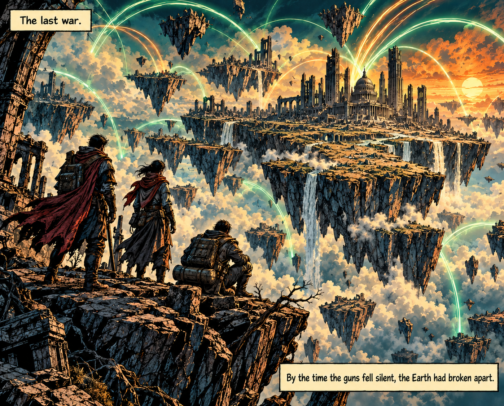](assets/panels/prologue-p01-panel01.png) | **Prologue P01 Panel01**<br>[assets/panels/prologue-p01-panel01.png](assets/panels/prologue-p01-panel01.png) | 1397 × 1126 · 3.1 MB | Page 1, panel 1 |
| [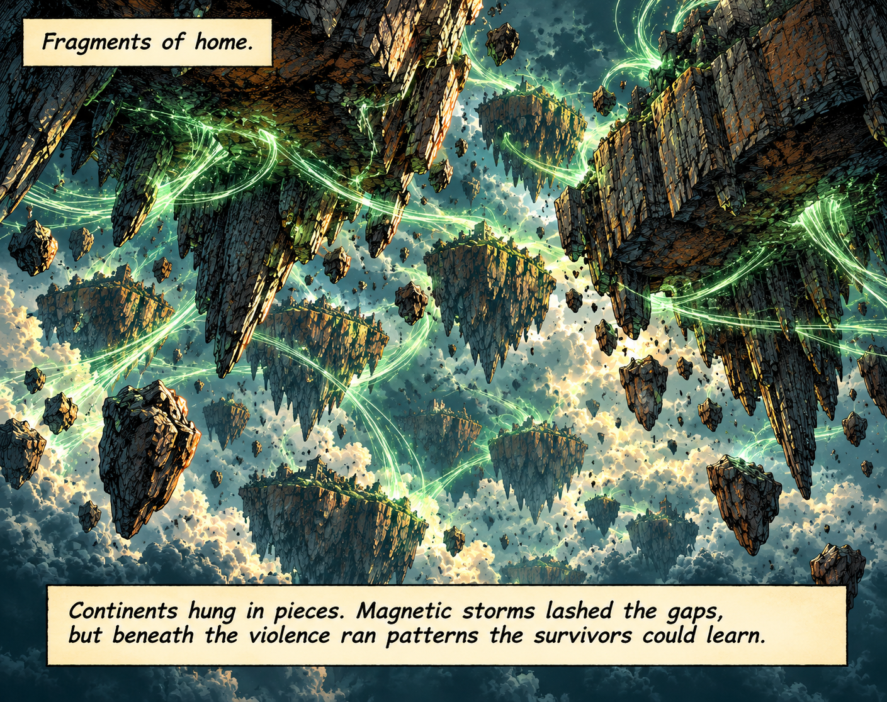](assets/panels/prologue-p01-panel02.png) | **Prologue P01 Panel02**<br>[assets/panels/prologue-p01-panel02.png](assets/panels/prologue-p01-panel02.png) | 1409 × 1116 · 3.3 MB | Page 1, panel 2 |
| [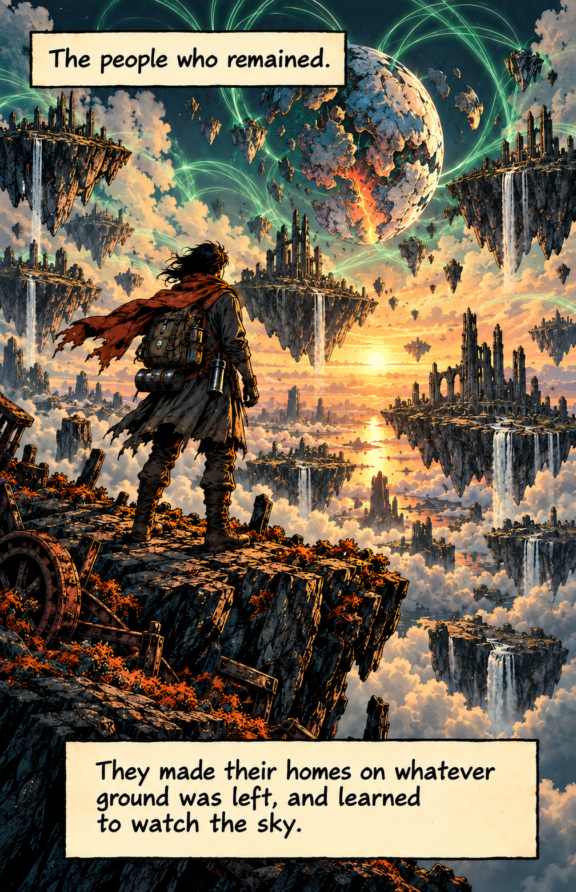](assets/panels/prologue-p01-panel03.png) | **Prologue P01 Panel03**<br>[assets/panels/prologue-p01-panel03.png](assets/panels/prologue-p01-panel03.png) | 1008 × 1560 · 2.9 MB | Page 1, panel 3 |
| [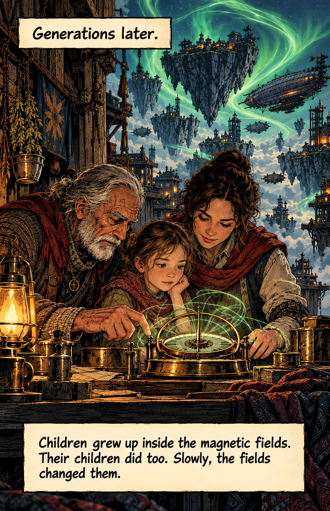](assets/panels/prologue-p02-panel01.png) | **Prologue P02 Panel01**<br>[assets/panels/prologue-p02-panel01.png](assets/panels/prologue-p02-panel01.png) | 1007 × 1561 · 3.1 MB | Page 2, panel 1 |
| [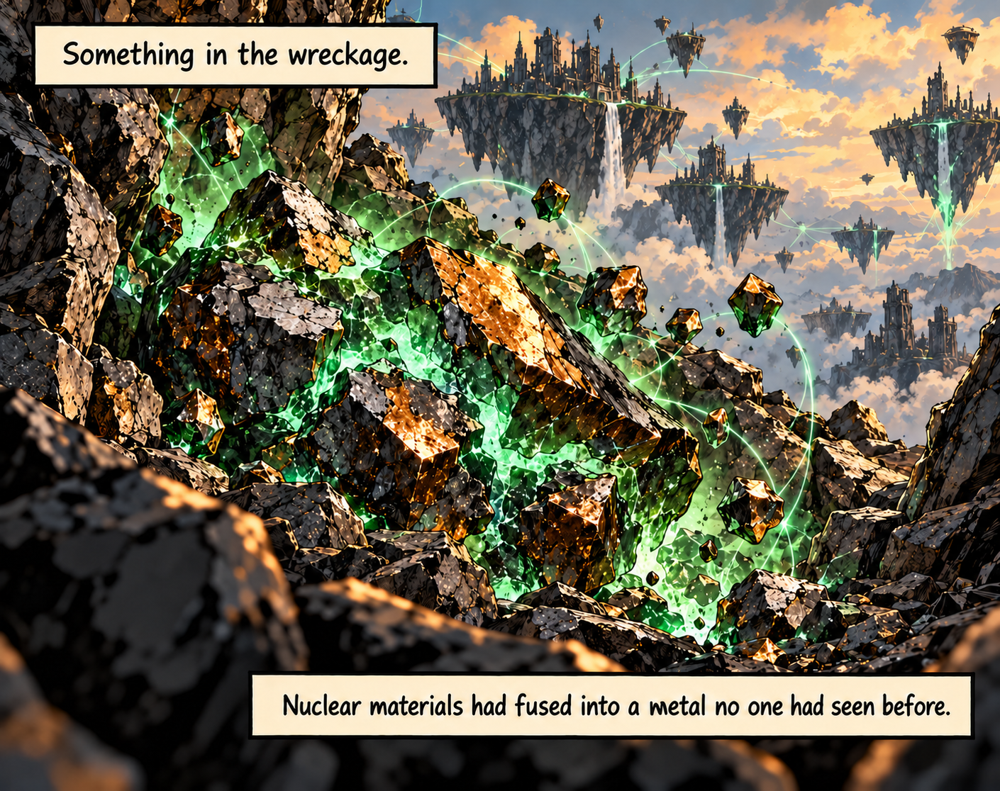](assets/panels/prologue-p02-panel02.png) | **Prologue P02 Panel02**<br>[assets/panels/prologue-p02-panel02.png](assets/panels/prologue-p02-panel02.png) | 1410 × 1116 · 2.8 MB | Page 2, panel 2 |
| [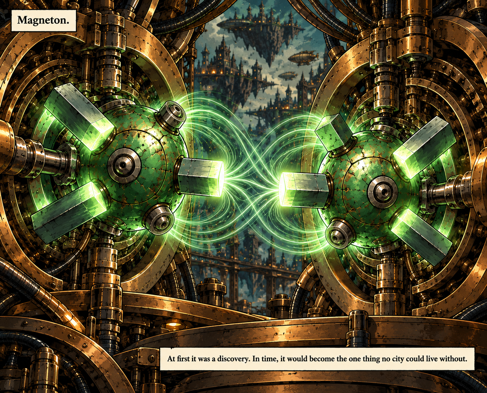](assets/panels/prologue-p02-panel03.png) | **Prologue P02 Panel03**<br>[assets/panels/prologue-p02-panel03.png](assets/panels/prologue-p02-panel03.png) | 1397 × 1126 · 3.1 MB | Page 2, panel 3 |
| [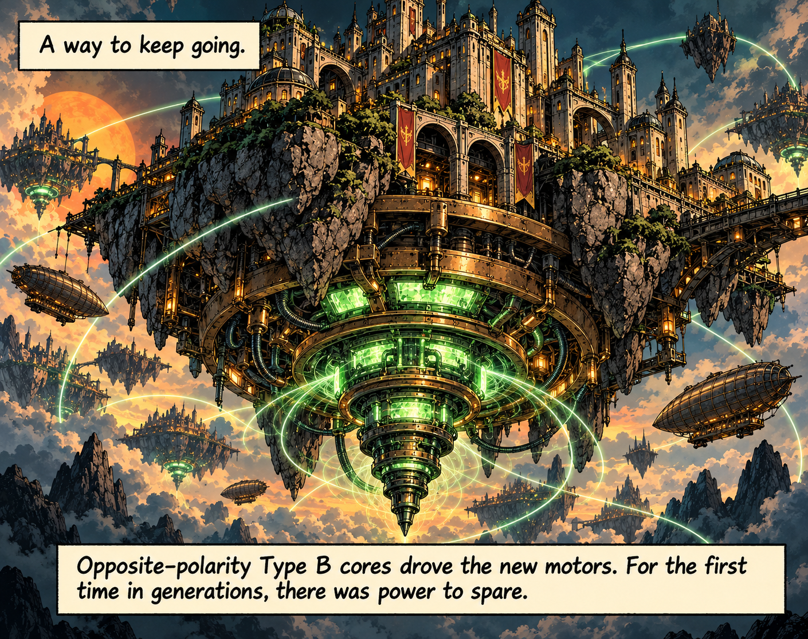](assets/panels/prologue-p03-panel01.png) | **Prologue P03 Panel01**<br>[assets/panels/prologue-p03-panel01.png](assets/panels/prologue-p03-panel01.png) | 1410 × 1116 · 3.2 MB | Page 3, panel 1 |
| [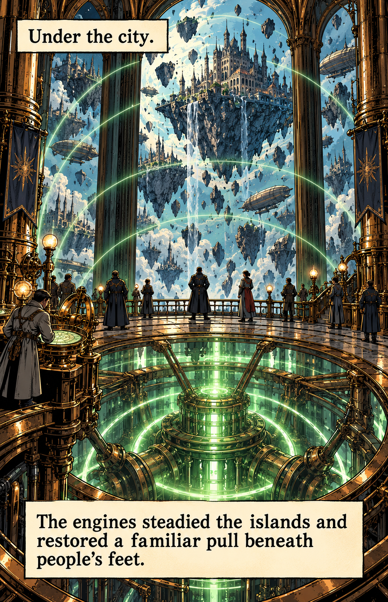](assets/panels/prologue-p03-panel02.png) | **Prologue P03 Panel02**<br>[assets/panels/prologue-p03-panel02.png](assets/panels/prologue-p03-panel02.png) | 1008 × 1561 · 3.2 MB | Page 3, panel 2 |
| [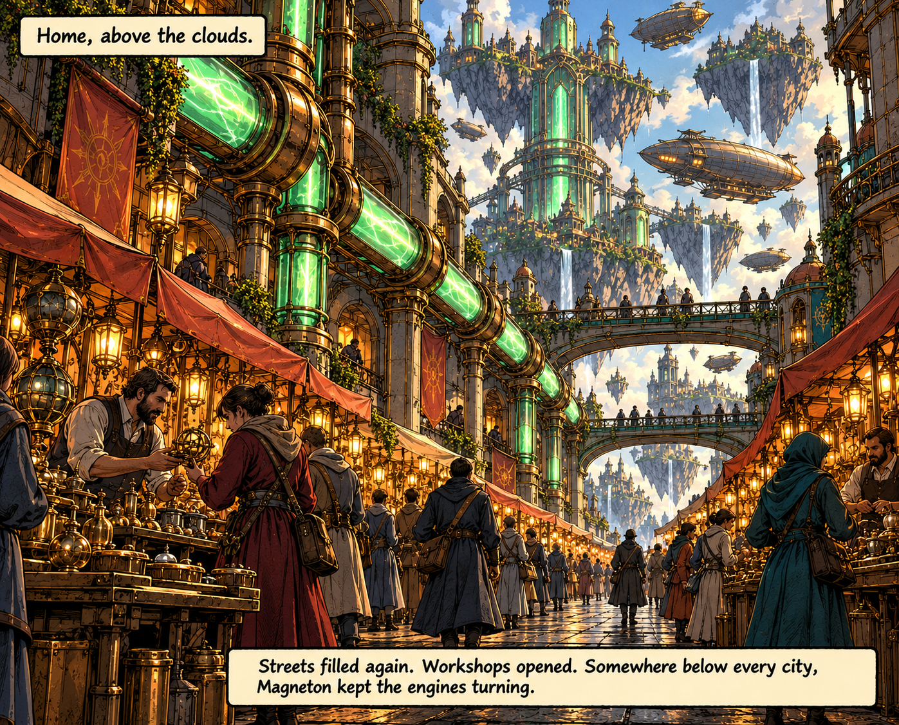](assets/panels/prologue-p03-panel03.png) | **Prologue P03 Panel03**<br>[assets/panels/prologue-p03-panel03.png](assets/panels/prologue-p03-panel03.png) | 1397 × 1126 · 3.4 MB | Page 3, panel 3 |
| [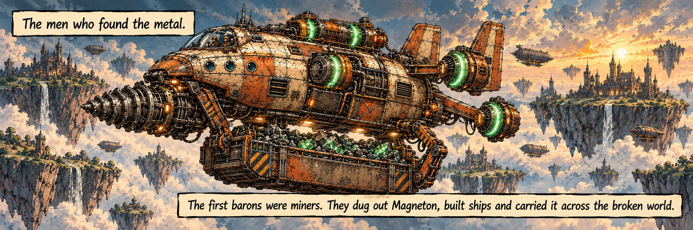](assets/panels/prologue-p04-panel01.png) | **Mole**<br>[assets/panels/prologue-p04-panel01.png](assets/panels/prologue-p04-panel01.png) | 2172 × 724 · 3.4 MB | Page 4, panel 1 |
| [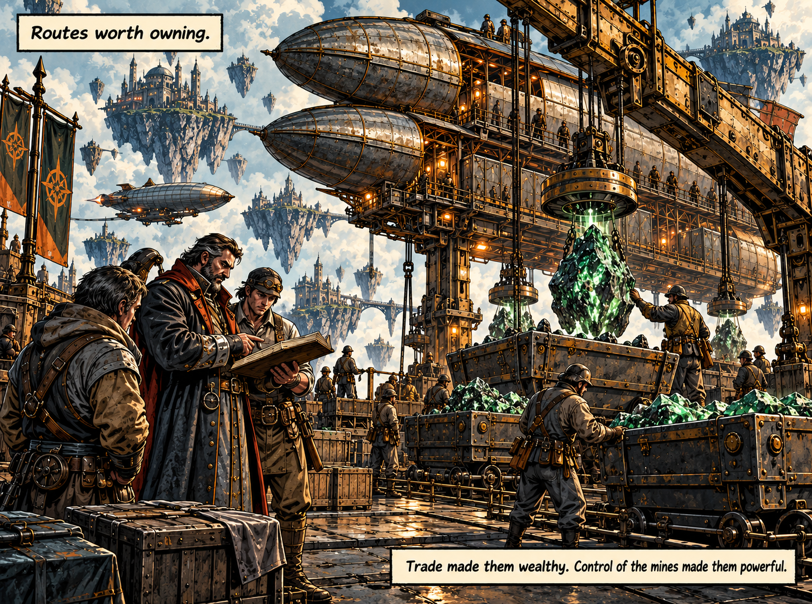](assets/panels/prologue-p04-panel02.png) | **Prologue P04 Panel02**<br>[assets/panels/prologue-p04-panel02.png](assets/panels/prologue-p04-panel02.png) | 1454 × 1082 · 3.3 MB | Page 4, panel 2 |
| [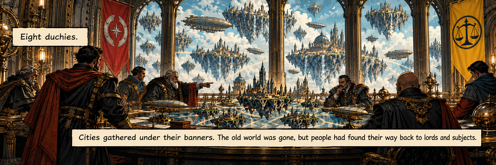](assets/panels/prologue-p04-panel03.png) | **Prologue P04 Panel03**<br>[assets/panels/prologue-p04-panel03.png](assets/panels/prologue-p04-panel03.png) | 2172 × 724 · 3.0 MB | Page 4, panel 3 |
| [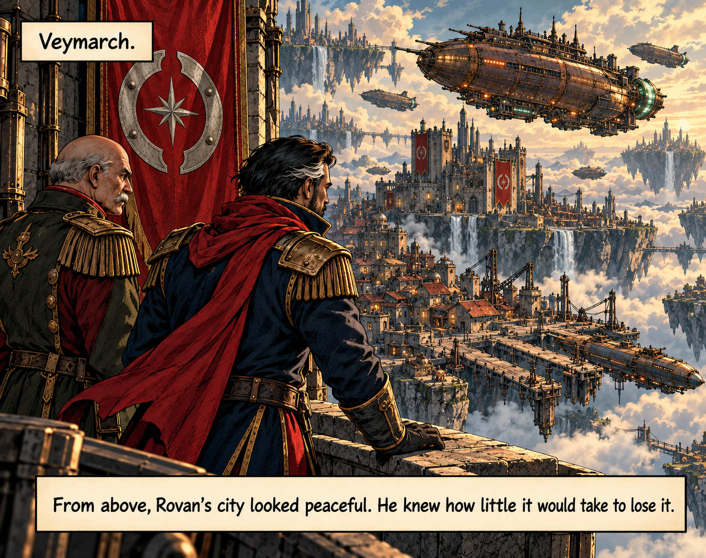](assets/panels/prologue-p05-panel01.png) | **Prologue P05 Panel01**<br>[assets/panels/prologue-p05-panel01.png](assets/panels/prologue-p05-panel01.png) | 1410 × 1116 · 2.9 MB | Page 5, panel 1 |
| [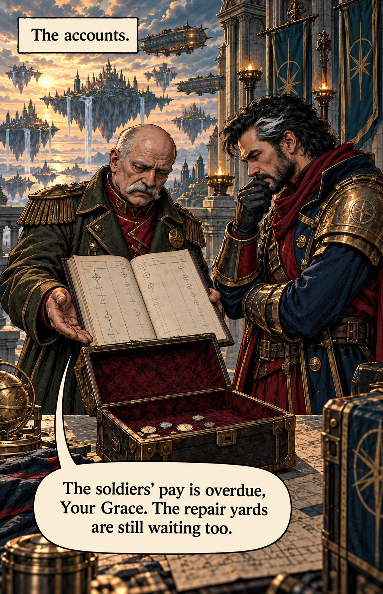](assets/panels/prologue-p05-panel02.png) | **Prologue P05 Panel02**<br>[assets/panels/prologue-p05-panel02.png](assets/panels/prologue-p05-panel02.png) | 1008 × 1561 · 2.7 MB | Page 5, panel 2 |
| [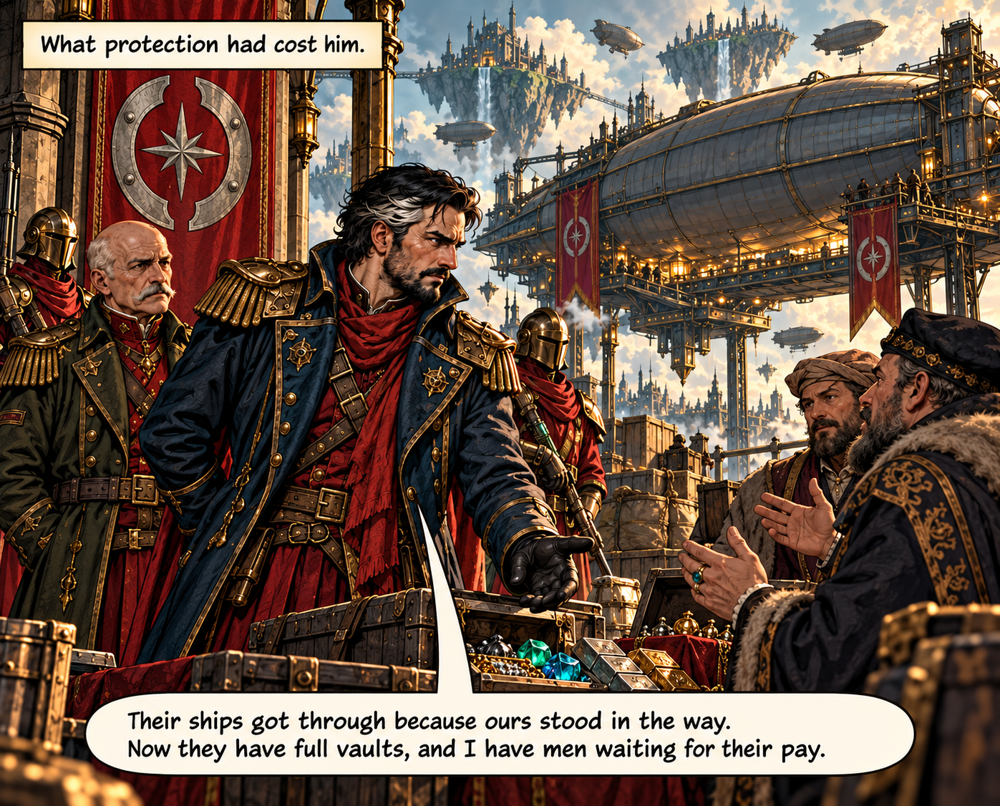](assets/panels/prologue-p05-panel03.png) | **Prologue P05 Panel03**<br>[assets/panels/prologue-p05-panel03.png](assets/panels/prologue-p05-panel03.png) | 1397 × 1126 · 2.8 MB | Page 5, panel 3 |
| [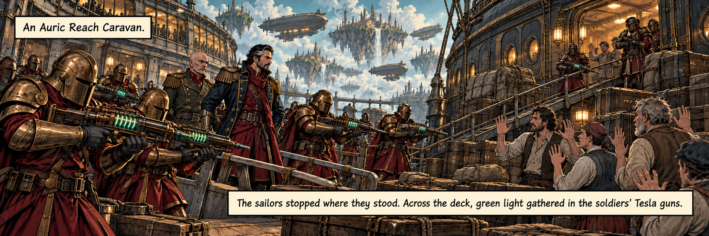](assets/panels/prologue-p06-panel01.png) | **Prologue P06 Panel01**<br>[assets/panels/prologue-p06-panel01.png](assets/panels/prologue-p06-panel01.png) | 2172 × 724 · 3.1 MB | Page 6, panel 1 |
| [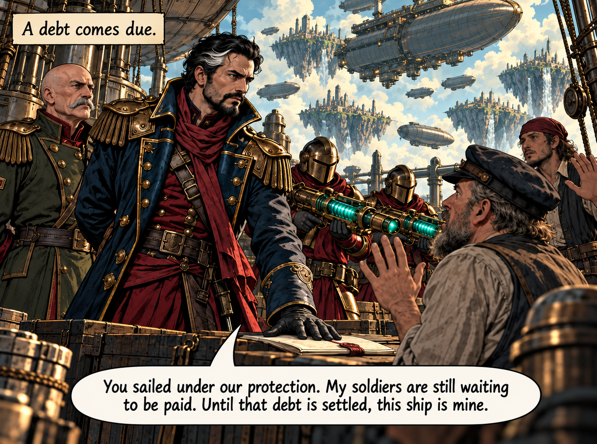](assets/panels/prologue-p06-panel02.png) | **Prologue P06 Panel02**<br>[assets/panels/prologue-p06-panel02.png](assets/panels/prologue-p06-panel02.png) | 1454 × 1082 · 2.6 MB | Page 6, panel 2 |
| [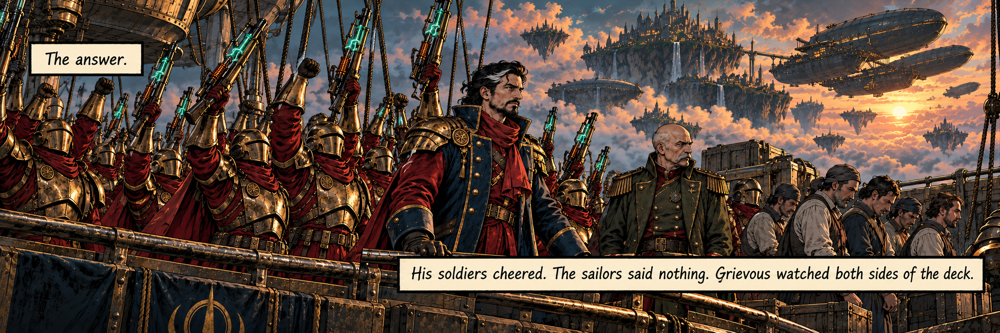](assets/panels/prologue-p06-panel03.png) | **Prologue P06 Panel03**<br>[assets/panels/prologue-p06-panel03.png](assets/panels/prologue-p06-panel03.png) | 2172 × 724 · 3.0 MB | Page 6, panel 3 |
| [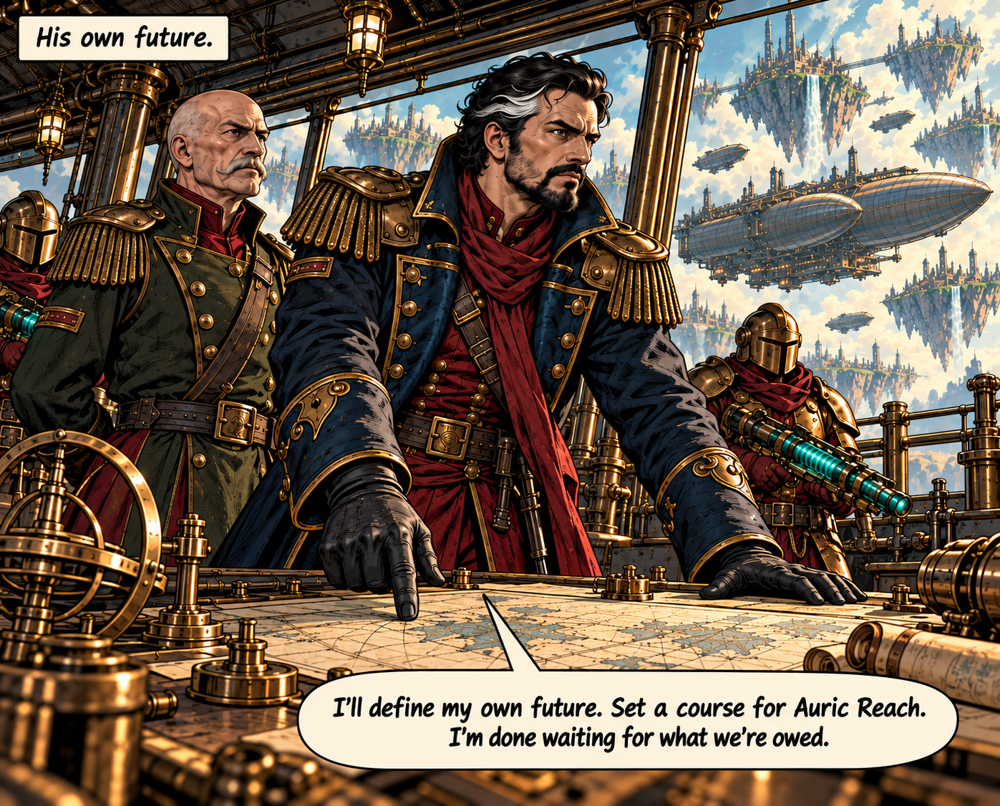](assets/panels/prologue-p07-panel01.png) | **Prologue P07 Panel01**<br>[assets/panels/prologue-p07-panel01.png](assets/panels/prologue-p07-panel01.png) | 1397 × 1126 · 2.9 MB | Page 7, panel 1 |
| [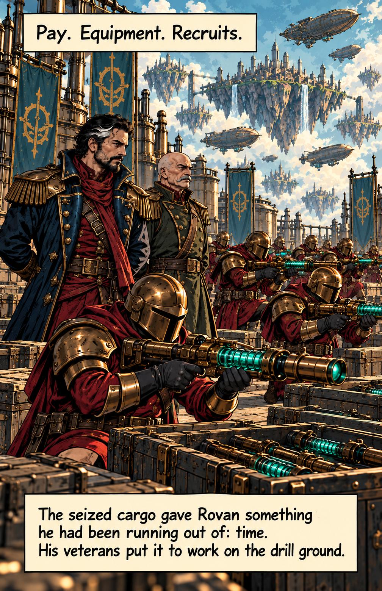](assets/panels/prologue-p07-panel02.png) | **Prologue P07 Panel02**<br>[assets/panels/prologue-p07-panel02.png](assets/panels/prologue-p07-panel02.png) | 1008 × 1560 · 2.7 MB | Page 7, panel 2 |
| [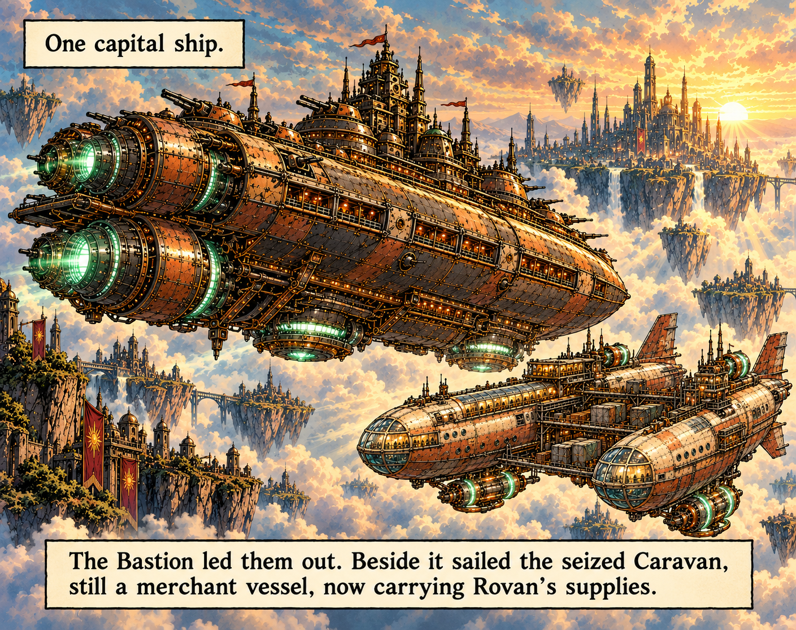](assets/panels/prologue-p07-panel03.png) | **Prologue P07 Panel03**<br>[assets/panels/prologue-p07-panel03.png](assets/panels/prologue-p07-panel03.png) | 1409 × 1116 · 3.3 MB | Page 7, panel 3 |
| [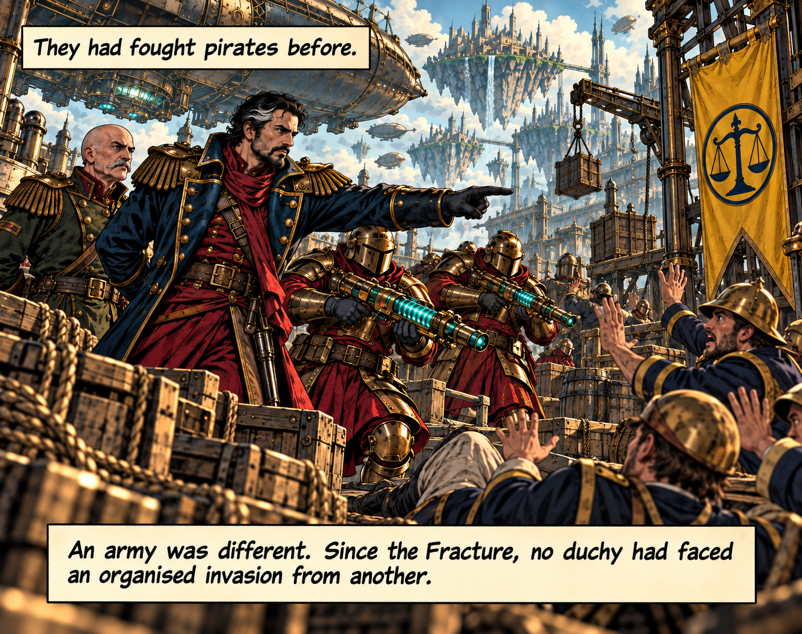](assets/panels/prologue-p08-panel01.png) | **Prologue P08 Panel01**<br>[assets/panels/prologue-p08-panel01.png](assets/panels/prologue-p08-panel01.png) | 1410 × 1116 · 2.8 MB | Page 8, panel 1 |
| [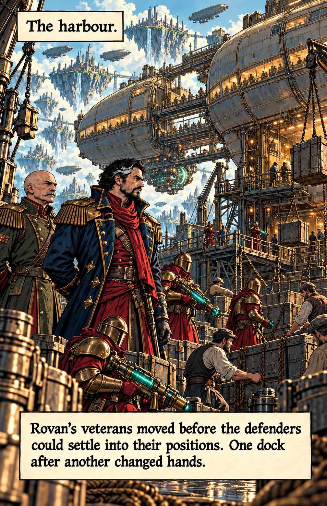](assets/panels/prologue-p08-panel02.png) | **Prologue P08 Panel02**<br>[assets/panels/prologue-p08-panel02.png](assets/panels/prologue-p08-panel02.png) | 1008 × 1560 · 3.1 MB | Page 8, panel 2 |
| [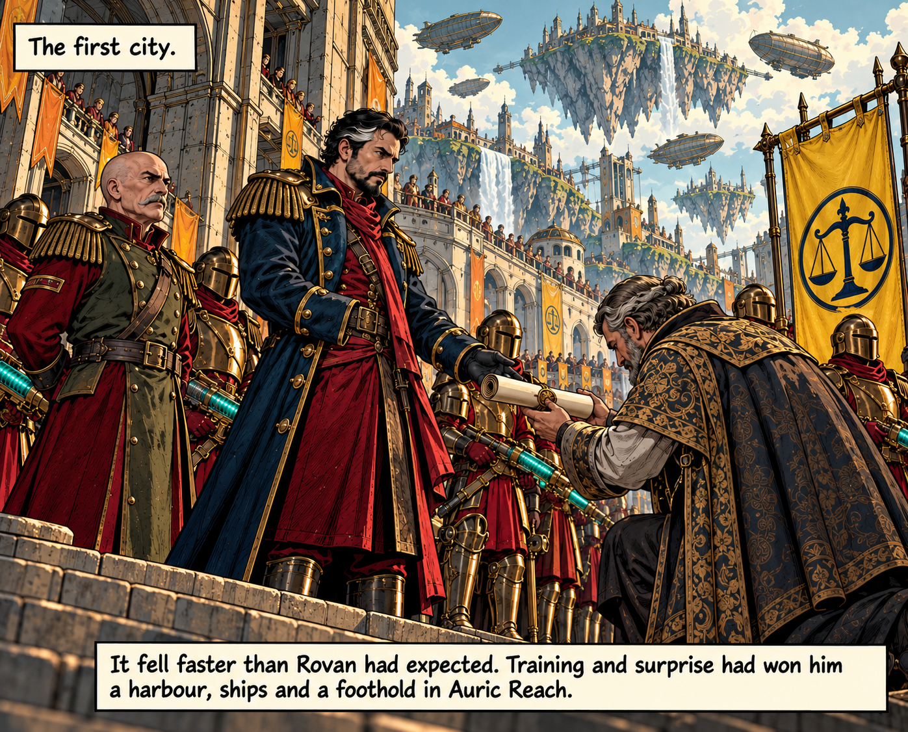](assets/panels/prologue-p08-panel03.png) | **Prologue P08 Panel03**<br>[assets/panels/prologue-p08-panel03.png](assets/panels/prologue-p08-panel03.png) | 1397 × 1126 · 3.0 MB | Page 8, panel 3 |
| [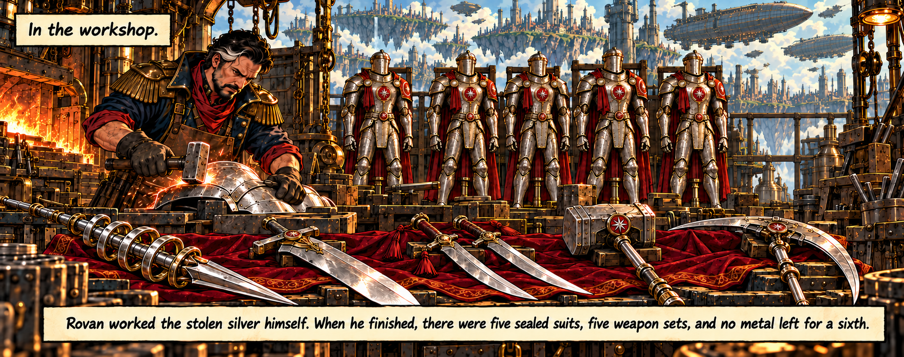](assets/panels/prologue-p09-panel01.png) | **Prologue P09 Panel01**<br>[assets/panels/prologue-p09-panel01.png](assets/panels/prologue-p09-panel01.png) | 1994 × 789 · 2.9 MB | Page 9, panel 1 |
| [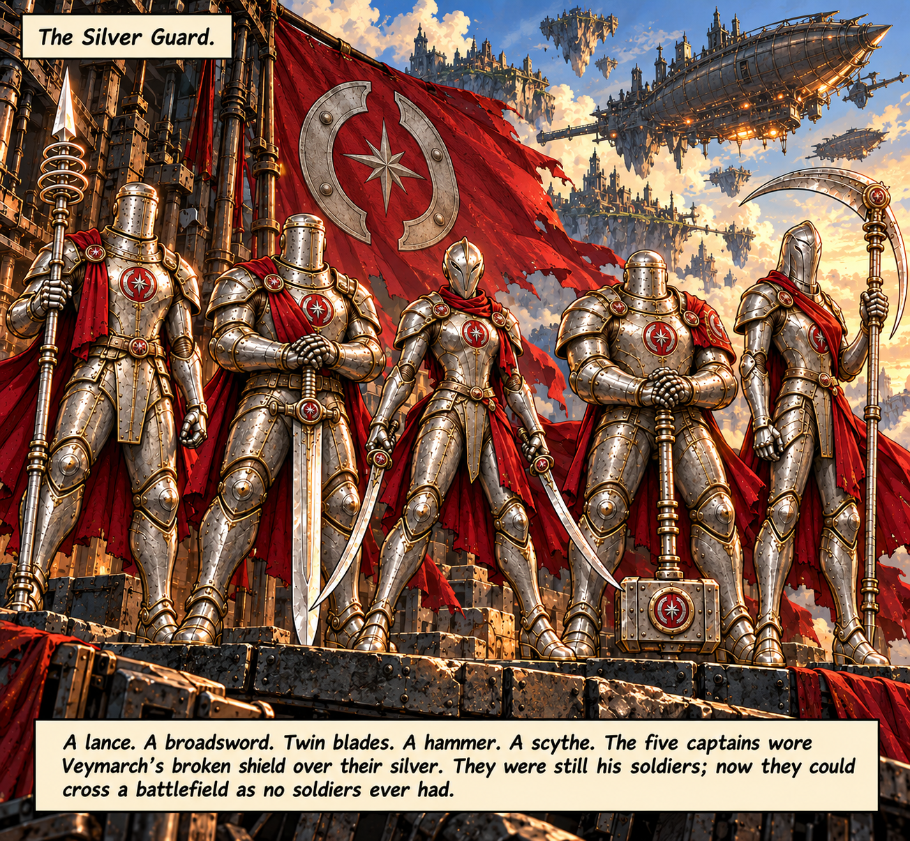](assets/panels/prologue-p09-panel02.png) | **Prologue P09 Panel02**<br>[assets/panels/prologue-p09-panel02.png](assets/panels/prologue-p09-panel02.png) | 1304 × 1206 · 3.3 MB | Page 9, panel 2 |
| [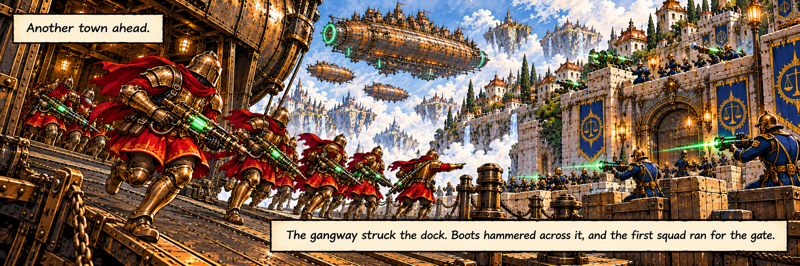](assets/panels/prologue-p10-panel01.png) | **Prologue P10 Panel01**<br>[assets/panels/prologue-p10-panel01.png](assets/panels/prologue-p10-panel01.png) | 2172 × 724 · 3.3 MB | Page 10, panel 1 |
| [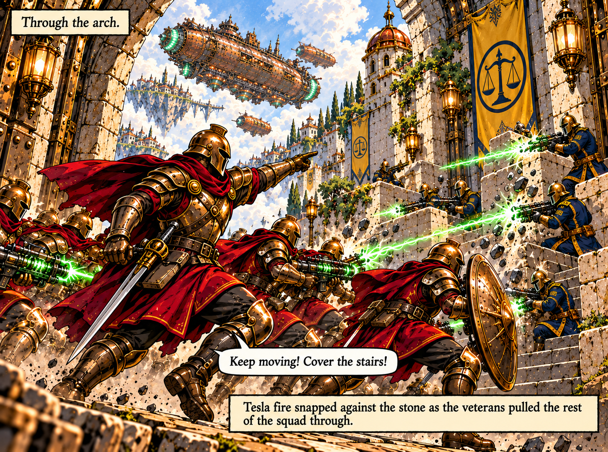](assets/panels/prologue-p10-panel02.png) | **Prologue P10 Panel02**<br>[assets/panels/prologue-p10-panel02.png](assets/panels/prologue-p10-panel02.png) | 1454 × 1082 · 3.3 MB | Page 10, panel 2 |
| [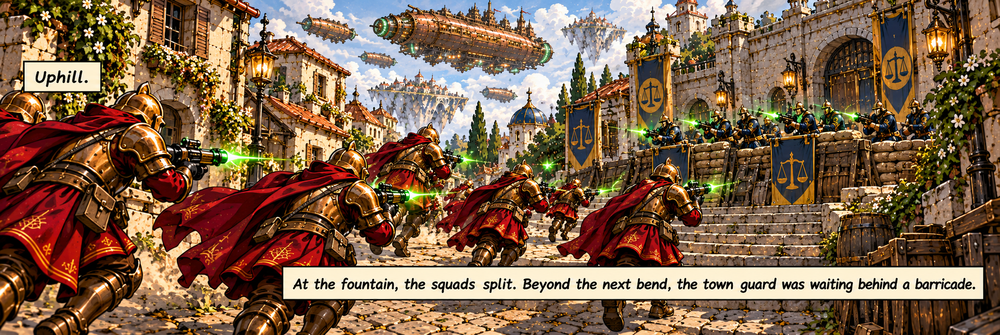](assets/panels/prologue-p10-panel03.png) | **Prologue P10 Panel03**<br>[assets/panels/prologue-p10-panel03.png](assets/panels/prologue-p10-panel03.png) | 2167 × 726 · 3.2 MB | Page 10, panel 3 |
| [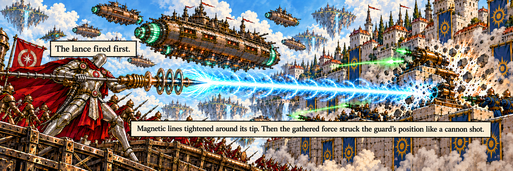](assets/panels/prologue-p11-panel01.png) | **Prologue P11 Panel01**<br>[assets/panels/prologue-p11-panel01.png](assets/panels/prologue-p11-panel01.png) | 2169 × 725 · 3.2 MB | Page 11, panel 1 |
| [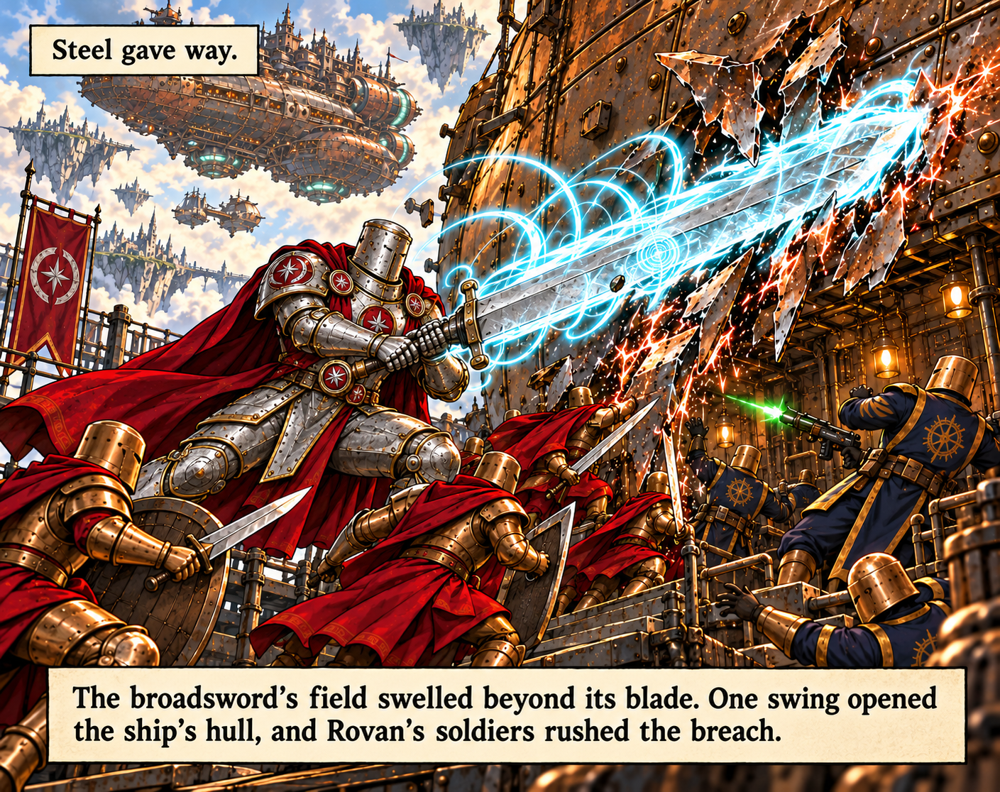](assets/panels/prologue-p11-panel02.png) | **Prologue P11 Panel02**<br>[assets/panels/prologue-p11-panel02.png](assets/panels/prologue-p11-panel02.png) | 1409 × 1116 · 3.1 MB | Page 11, panel 2 |
| [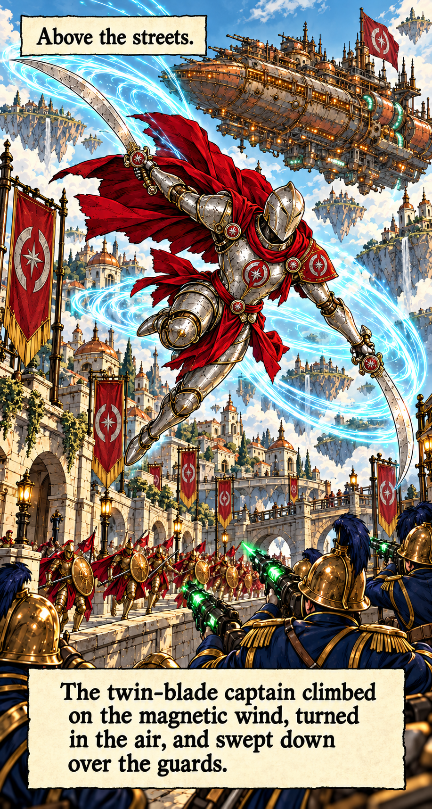](assets/panels/prologue-p11-panel03.png) | **Prologue P11 Panel03**<br>[assets/panels/prologue-p11-panel03.png](assets/panels/prologue-p11-panel03.png) | 917 × 1716 · 3.2 MB | Page 11, panel 3 |
| [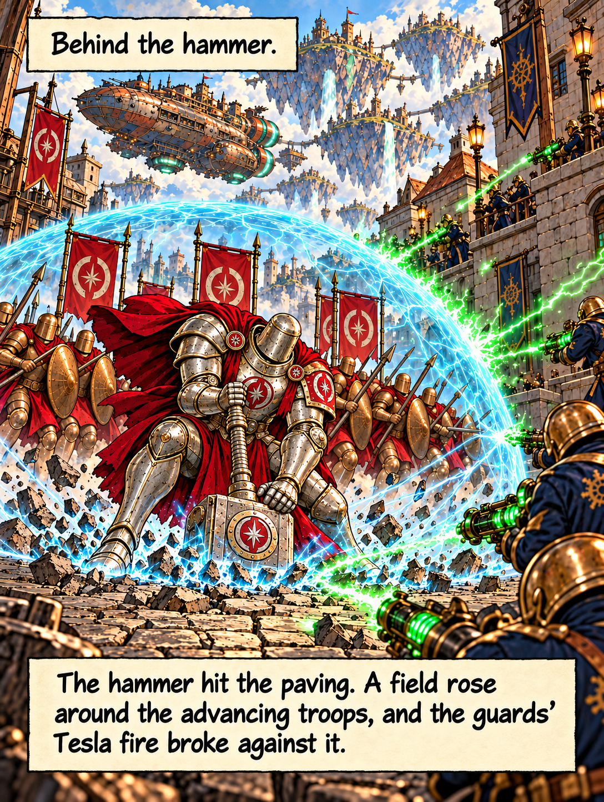](assets/panels/prologue-p11-panel04.png) | **Prologue P11 Panel04**<br>[assets/panels/prologue-p11-panel04.png](assets/panels/prologue-p11-panel04.png) | 1088 × 1445 · 3.2 MB | Page 11, panel 4 |
| [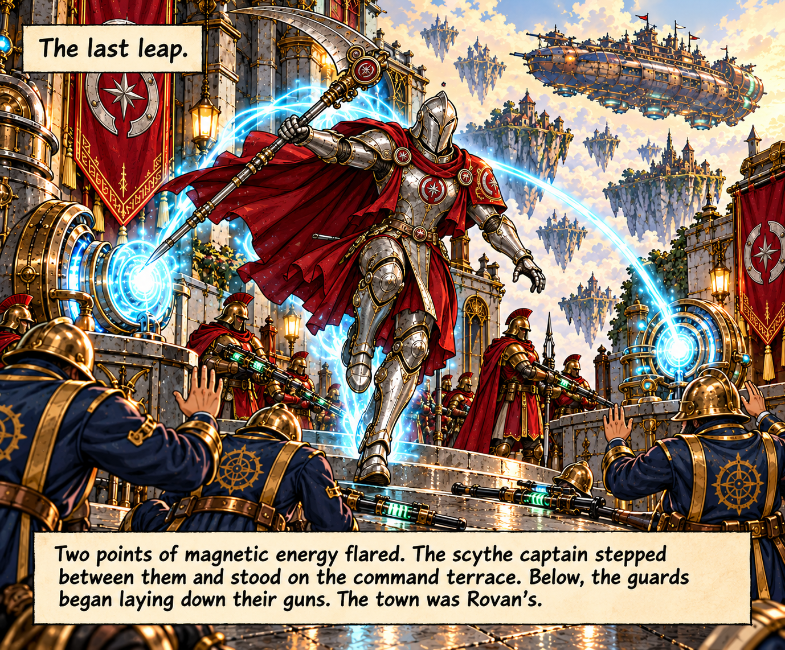](assets/panels/prologue-p11-panel05.png) | **Prologue P11 Panel05**<br>[assets/panels/prologue-p11-panel05.png](assets/panels/prologue-p11-panel05.png) | 1378 × 1142 · 3.1 MB | Page 11, panel 5 |
| [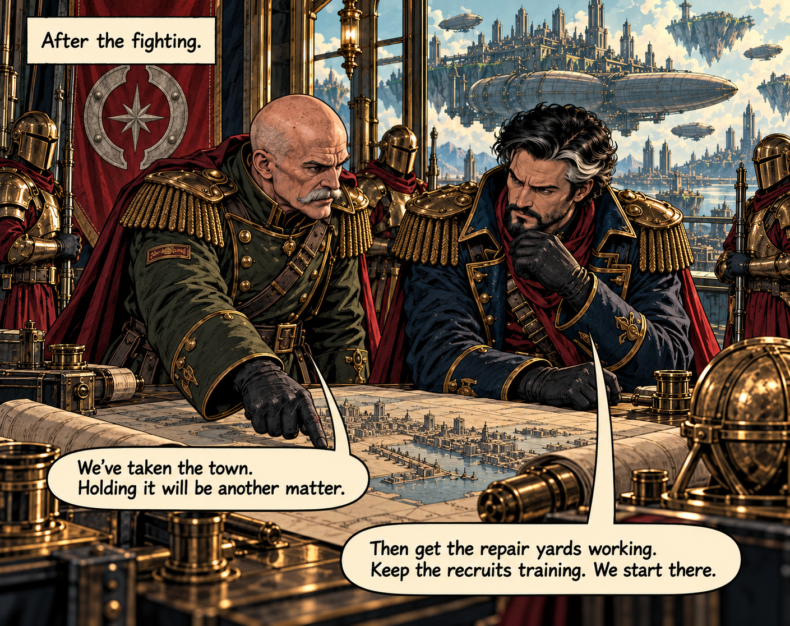](assets/panels/prologue-p12-panel01.png) | **Prologue P12 Panel01**<br>[assets/panels/prologue-p12-panel01.png](assets/panels/prologue-p12-panel01.png) | 1409 × 1116 · 2.8 MB | Page 12, panel 1 |
| [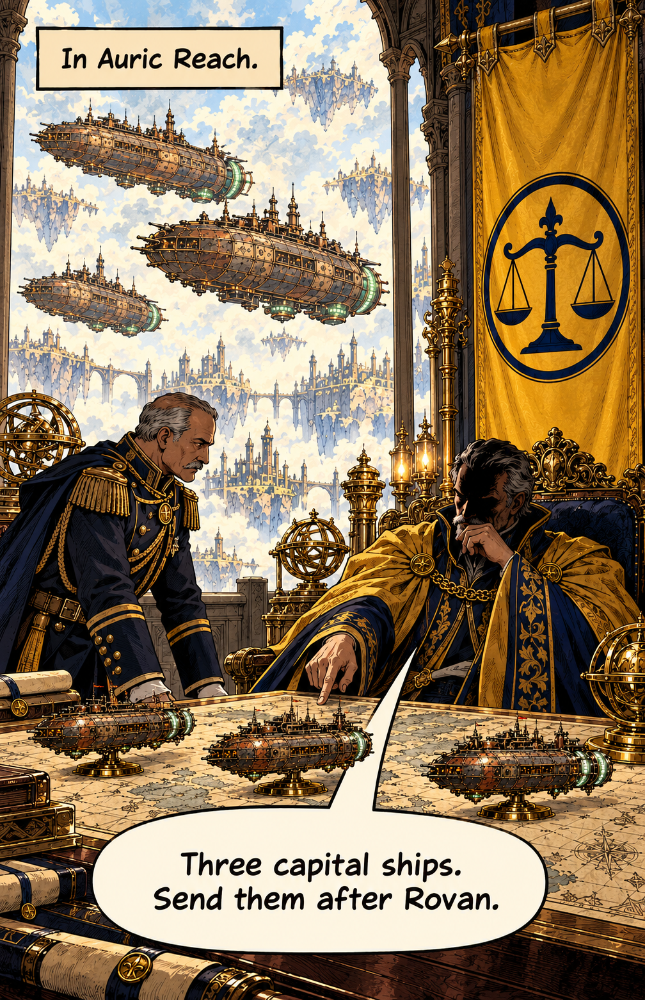](assets/panels/prologue-p12-panel02.png) | **Prologue P12 Panel02**<br>[assets/panels/prologue-p12-panel02.png](assets/panels/prologue-p12-panel02.png) | 1008 × 1561 · 3.1 MB | Page 12, panel 2 |
| [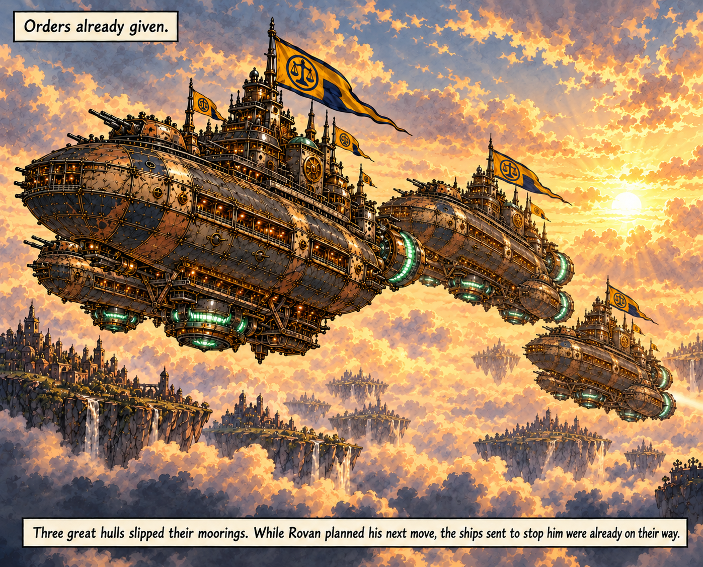](assets/panels/prologue-p12-panel03.png) | **Prologue P12 Panel03**<br>[assets/panels/prologue-p12-panel03.png](assets/panels/prologue-p12-panel03.png) | 1397 × 1126 · 2.9 MB | Page 12, panel 3 |
| [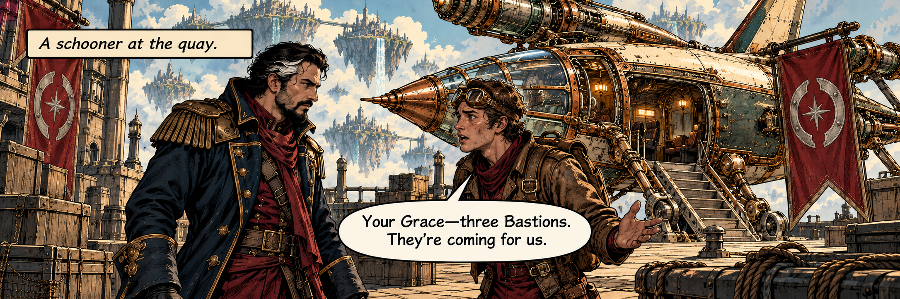](assets/panels/prologue-p13-panel01.png) | **Prologue P13 Panel01**<br>[assets/panels/prologue-p13-panel01.png](assets/panels/prologue-p13-panel01.png) | 2172 × 724 · 3.2 MB | Page 13, panel 1 |
| [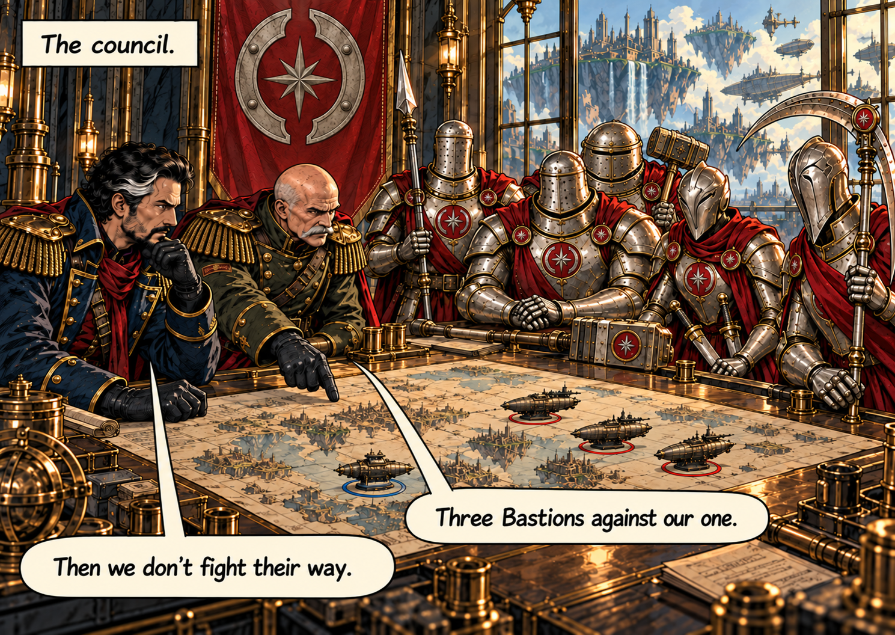](assets/panels/prologue-p13-panel02.png) | **Prologue P13 Panel02**<br>[assets/panels/prologue-p13-panel02.png](assets/panels/prologue-p13-panel02.png) | 1489 × 1056 · 2.9 MB | Page 13, panel 2 |
| [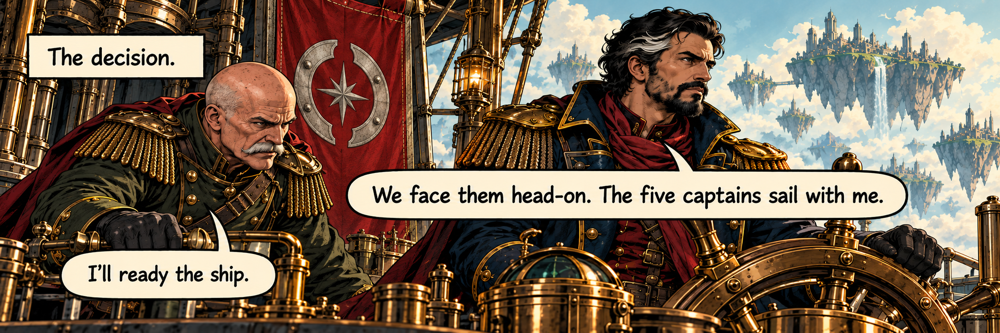](assets/panels/prologue-p13-panel03.png) | **Prologue P13 Panel03**<br>[assets/panels/prologue-p13-panel03.png](assets/panels/prologue-p13-panel03.png) | 2171 × 724 · 2.7 MB | Page 13, panel 3 |
| [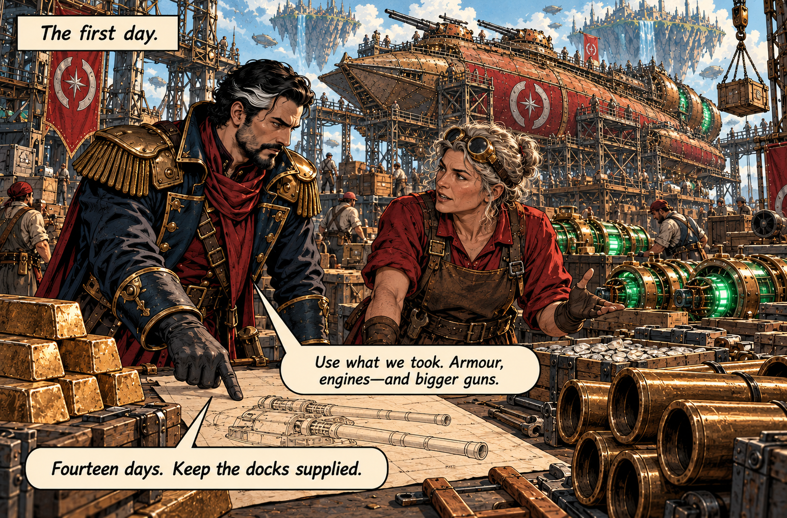](assets/panels/prologue-p14-panel01.png) | **Prologue P14 Panel01**<br>[assets/panels/prologue-p14-panel01.png](assets/panels/prologue-p14-panel01.png) | 1544 × 1018 · 3.3 MB | Page 14, panel 1 |
| [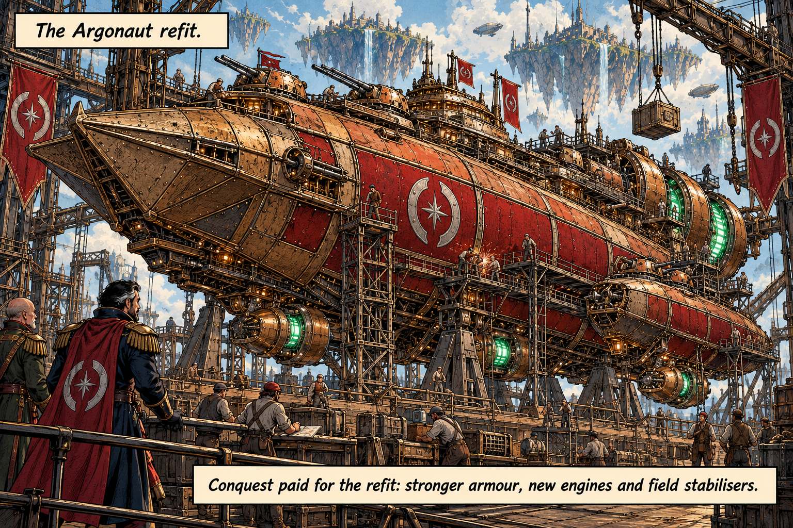](assets/argonaut-refit.png) | **The Argonaut refit**<br>[assets/argonaut-refit.png](assets/argonaut-refit.png) | 1543 × 1019 · 3.6 MB | Page 14, panel 2 |
| [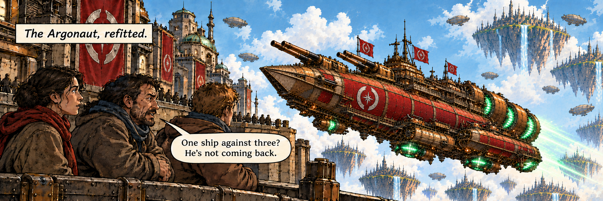](assets/panels/prologue-p15-panel01.png) | **Prologue P15 Panel01**<br>[assets/panels/prologue-p15-panel01.png](assets/panels/prologue-p15-panel01.png) | 2169 × 725 · 2.9 MB | Page 15, panel 1 |
| [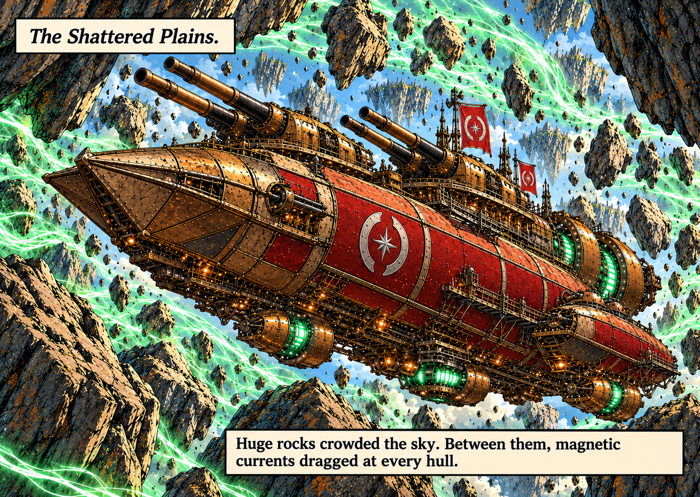](assets/panels/prologue-p15-panel02.png) | **Prologue P15 Panel02**<br>[assets/panels/prologue-p15-panel02.png](assets/panels/prologue-p15-panel02.png) | 1487 × 1058 · 3.8 MB | Page 15, panel 2 |
| [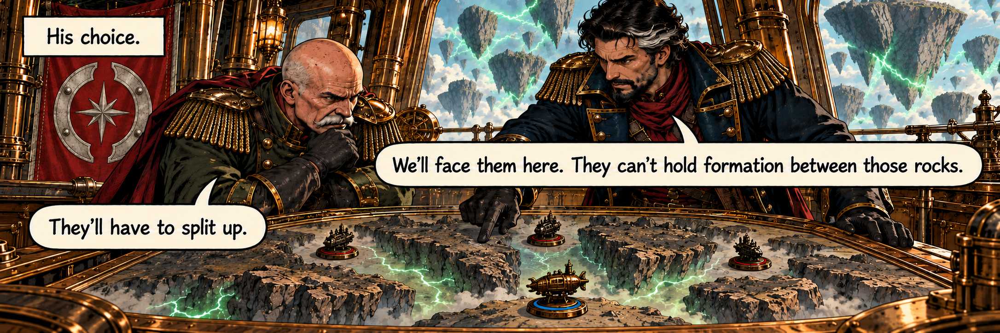](assets/panels/prologue-p15-panel03.png) | **Prologue P15 Panel03**<br>[assets/panels/prologue-p15-panel03.png](assets/panels/prologue-p15-panel03.png) | 2172 × 724 · 2.8 MB | Page 15, panel 3 |
| [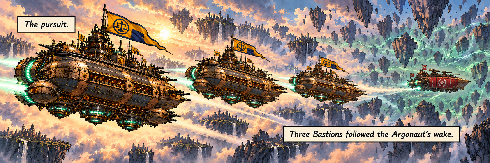](assets/panels/prologue-p16-panel01.png) | **Prologue P16 Panel01**<br>[assets/panels/prologue-p16-panel01.png](assets/panels/prologue-p16-panel01.png) | 2172 × 724 · 3.0 MB | Page 16, panel 1 |
| [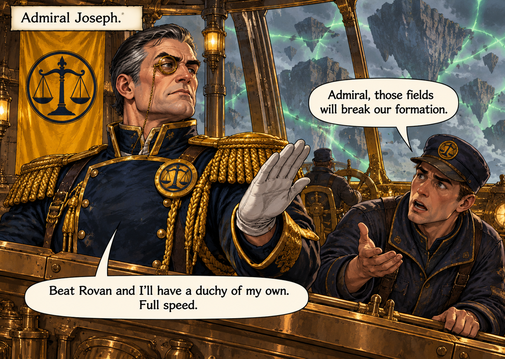](assets/panels/prologue-p16-panel02.png) | **Prologue P16 Panel02**<br>[assets/panels/prologue-p16-panel02.png](assets/panels/prologue-p16-panel02.png) | 1487 × 1058 · 2.7 MB | Page 16, panel 2 |
| [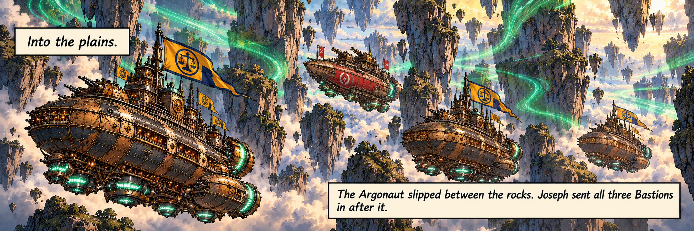](assets/panels/prologue-p16-panel03.png) | **Prologue P16 Panel03**<br>[assets/panels/prologue-p16-panel03.png](assets/panels/prologue-p16-panel03.png) | 2172 × 724 · 3.3 MB | Page 16, panel 3 |
| [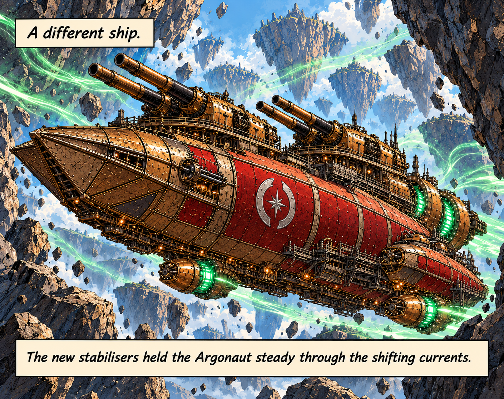](assets/panels/prologue-p17-panel01.png) | **Prologue P17 Panel01**<br>[assets/panels/prologue-p17-panel01.png](assets/panels/prologue-p17-panel01.png) | 1410 × 1116 · 3.5 MB | Page 17, panel 1 |
| [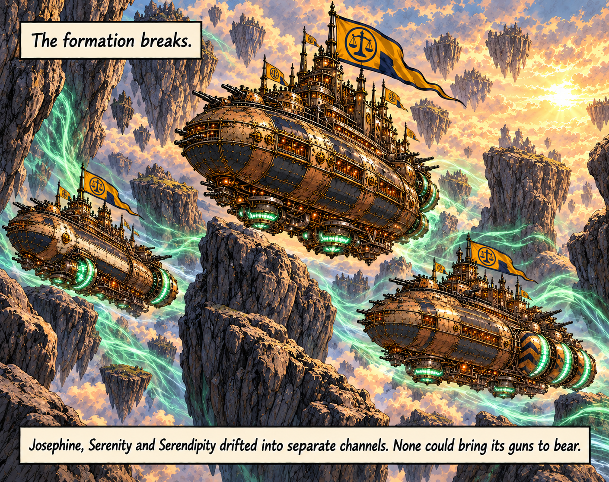](assets/panels/prologue-p17-panel02.png) | **Prologue P17 Panel02**<br>[assets/panels/prologue-p17-panel02.png](assets/panels/prologue-p17-panel02.png) | 1409 × 1116 · 3.4 MB | Page 17, panel 2 |
| [](assets/panels/prologue-p17-panel03.png) | **Prologue P17 Panel03**<br>[assets/panels/prologue-p17-panel03.png](assets/panels/prologue-p17-panel03.png) | 2066 × 761 · 3.0 MB | Page 17, panel 3 |
| [](assets/panels/prologue-p17-panel04.png) | **Prologue P17 Panel04**<br>[assets/panels/prologue-p17-panel04.png](assets/panels/prologue-p17-panel04.png) | 1694 × 928 · 3.3 MB | Page 17, panel 4 |
| [](assets/panels/prologue-p18-panel01.png) | **Prologue P18 Panel01**<br>[assets/panels/prologue-p18-panel01.png](assets/panels/prologue-p18-panel01.png) | 2172 × 724 · 3.1 MB | Page 18, panel 1 |
| [](assets/panels/prologue-p18-panel02.png) | **Prologue P18 Panel02**<br>[assets/panels/prologue-p18-panel02.png](assets/panels/prologue-p18-panel02.png) | 1345 × 1170 · 3.3 MB | Page 18, panel 2 |
| [](assets/panels/prologue-p18-panel03.png) | **Prologue P18 Panel03**<br>[assets/panels/prologue-p18-panel03.png](assets/panels/prologue-p18-panel03.png) | 1064 × 1478 · 3.3 MB | Page 18, panel 3 |
| [](assets/panels/prologue-p18-panel04.png) | **Prologue P18 Panel04**<br>[assets/panels/prologue-p18-panel04.png](assets/panels/prologue-p18-panel04.png) | 1160 × 1355 · 3.2 MB | Page 18, panel 4 |
| [](assets/panels/prologue-p18-panel05.png) | **Prologue P18 Panel05**<br>[assets/panels/prologue-p18-panel05.png](assets/panels/prologue-p18-panel05.png) | 1264 × 1244 · 3.0 MB | Page 18, panel 5 |
| [](assets/panels/prologue-p19-panel01.png) | **Prologue P19 Panel01**<br>[assets/panels/prologue-p19-panel01.png](assets/panels/prologue-p19-panel01.png) | 2172 × 724 · 3.0 MB | Page 19, panel 1 |
| [](assets/panels/prologue-p19-panel02.png) | **Prologue P19 Panel02**<br>[assets/panels/prologue-p19-panel02.png](assets/panels/prologue-p19-panel02.png) | 1344 × 1170 · 2.9 MB | Page 19, panel 2 |
| [](assets/panels/prologue-p19-panel03.png) | **Prologue P19 Panel03**<br>[assets/panels/prologue-p19-panel03.png](assets/panels/prologue-p19-panel03.png) | 1064 × 1478 · 2.7 MB | Page 19, panel 3 |
| [](assets/panels/prologue-p19-panel04.png) | **Prologue P19 Panel04**<br>[assets/panels/prologue-p19-panel04.png](assets/panels/prologue-p19-panel04.png) | 1160 × 1356 · 2.8 MB | Page 19, panel 4 |
| [](assets/panels/prologue-p19-panel05.png) | **Prologue P19 Panel05**<br>[assets/panels/prologue-p19-panel05.png](assets/panels/prologue-p19-panel05.png) | 1277 × 1232 · 3.1 MB | Page 19, panel 5 |
| [](assets/panels/prologue-p20-panel01.png) | **Prologue P20 Panel01**<br>[assets/panels/prologue-p20-panel01.png](assets/panels/prologue-p20-panel01.png) | 2172 × 724 · 3.0 MB | Page 20, panel 1 |
| [](assets/panels/prologue-p20-panel02.png) | **Prologue P20 Panel02**<br>[assets/panels/prologue-p20-panel02.png](assets/panels/prologue-p20-panel02.png) | 1344 × 1170 · 2.6 MB | Page 20, panel 2 |
| [](assets/panels/prologue-p20-panel03.png) | **Prologue P20 Panel03**<br>[assets/panels/prologue-p20-panel03.png](assets/panels/prologue-p20-panel03.png) | 1064 × 1478 · 3.0 MB | Page 20, panel 3 |
| [](assets/panels/prologue-p20-panel04.png) | **Prologue P20 Panel04**<br>[assets/panels/prologue-p20-panel04.png](assets/panels/prologue-p20-panel04.png) | 1159 × 1356 · 2.5 MB | Page 20, panel 4 |
| [](assets/panels/prologue-p20-panel05.png) | **Prologue P20 Panel05**<br>[assets/panels/prologue-p20-panel05.png](assets/panels/prologue-p20-panel05.png) | 1265 × 1244 · 3.0 MB | Page 20, panel 5 |
| [](assets/panels/prologue-p21-panel01.png) | **Prologue P21 Panel01**<br>[assets/panels/prologue-p21-panel01.png](assets/panels/prologue-p21-panel01.png) | 1812 × 868 · 3.2 MB | Page 21, panel 1 |
| [](assets/panels/prologue-p21-panel02.png) | **Prologue P21 Panel02**<br>[assets/panels/prologue-p21-panel02.png](assets/panels/prologue-p21-panel02.png) | 1335 × 1178 · 2.8 MB | Page 21, panel 2 |
| [](assets/panels/prologue-p21-panel03.png) | **Prologue P21 Panel03**<br>[assets/panels/prologue-p21-panel03.png](assets/panels/prologue-p21-panel03.png) | 1555 × 1011 · 3.3 MB | Page 21, panel 3 |
| [](assets/panels/prologue-p21-panel04.png) | **Prologue P21 Panel04**<br>[assets/panels/prologue-p21-panel04.png](assets/panels/prologue-p21-panel04.png) | 1854 × 848 · 2.9 MB | Page 21, panel 4 |
| [](assets/panels/prologue-p22-panel01.png) | **Prologue P22 Panel01**<br>[assets/panels/prologue-p22-panel01.png](assets/panels/prologue-p22-panel01.png) | 1688 × 932 · 3.3 MB | Page 22, panel 1 |
| [](assets/panels/prologue-p22-panel02.png) | **Prologue P22 Panel02**<br>[assets/panels/prologue-p22-panel02.png](assets/panels/prologue-p22-panel02.png) | 1335 × 1178 · 2.9 MB | Page 22, panel 2 |
| [](assets/panels/prologue-p22-panel03.png) | **Prologue P22 Panel03**<br>[assets/panels/prologue-p22-panel03.png](assets/panels/prologue-p22-panel03.png) | 1555 × 1012 · 3.0 MB | Page 22, panel 3 |
| [](assets/panels/prologue-p22-panel04.png) | **Prologue P22 Panel04**<br>[assets/panels/prologue-p22-panel04.png](assets/panels/prologue-p22-panel04.png) | 2003 × 785 · 3.0 MB | Page 22, panel 4 |
| [](assets/panels/prologue-p23-panel01.png) | **Prologue P23 Panel01**<br>[assets/panels/prologue-p23-panel01.png](assets/panels/prologue-p23-panel01.png) | 1926 × 817 · 2.9 MB | Page 23, panel 1 |
| [](assets/panels/prologue-p23-panel02.png) | **Prologue P23 Panel02**<br>[assets/panels/prologue-p23-panel02.png](assets/panels/prologue-p23-panel02.png) | 1335 × 1178 · 2.8 MB | Page 23, panel 2 |
| [](assets/panels/prologue-p23-panel03.png) | **Prologue P23 Panel03**<br>[assets/panels/prologue-p23-panel03.png](assets/panels/prologue-p23-panel03.png) | 1555 × 1012 · 2.8 MB | Page 23, panel 3 |
| [](assets/panels/prologue-p23-panel04.png) | **Prologue P23 Panel04**<br>[assets/panels/prologue-p23-panel04.png](assets/panels/prologue-p23-panel04.png) | 1734 × 907 · 2.8 MB | Page 23, panel 4 |
| [](assets/panels/prologue-p24-panel01.png) | **Prologue P24 Panel01**<br>[assets/panels/prologue-p24-panel01.png](assets/panels/prologue-p24-panel01.png) | 1926 × 817 · 2.6 MB | Page 24, panel 1 |
| [](assets/panels/prologue-p24-panel02.png) | **Prologue P24 Panel02**<br>[assets/panels/prologue-p24-panel02.png](assets/panels/prologue-p24-panel02.png) | 1335 × 1178 · 3.1 MB | Page 24, panel 2 |
| [](assets/panels/prologue-p24-panel03.png) | **Prologue P24 Panel03**<br>[assets/panels/prologue-p24-panel03.png](assets/panels/prologue-p24-panel03.png) | 1558 × 1010 · 2.9 MB | Page 24, panel 3 |
| [](assets/panels/prologue-p24-panel04.png) | **Prologue P24 Panel04**<br>[assets/panels/prologue-p24-panel04.png](assets/panels/prologue-p24-panel04.png) | 1734 × 907 · 2.8 MB | Page 24, panel 4 |

## Ships

| Preview | Asset | Size | Used in the comic |
| --- | --- | --- | --- |
| [](assets/mining-mole.png) | **Mole**<br>[assets/mining-mole.png](assets/mining-mole.png) | 1536 × 1024 · 3.2 MB | Reference artwork |
| [](assets/schooner-needle.png) | **Needle**<br>[assets/schooner-needle.png](assets/schooner-needle.png) | 1536 × 1024 · 2.5 MB | Reference artwork |
| [](assets/schooner-kestrel.png) | **Kestrel**<br>[assets/schooner-kestrel.png](assets/schooner-kestrel.png) | 1536 × 1024 · 3.3 MB | Reference artwork |
| [](assets/trader-caravan.png) | **Caravan**<br>[assets/trader-caravan.png](assets/trader-caravan.png) | 1536 × 1024 · 3.2 MB | Reference artwork |
| [](assets/trader-terrace.png) | **Terrace**<br>[assets/trader-terrace.png](assets/trader-terrace.png) | 1536 × 1024 · 3.2 MB | Reference artwork |
| [](assets/capital-bastion.png) | **Bastion**<br>[assets/capital-bastion.png](assets/capital-bastion.png) | 1536 × 1024 · 3.2 MB | Reference artwork |

## World references

| Preview | Asset | Size | Used in the comic |
| --- | --- | --- | --- |
| [](assets/magneton-types.png) | **Magneton metal specimens**<br>[assets/magneton-types.png](assets/magneton-types.png) | 1536 × 1024 · 3.0 MB | Reference artwork |
| [](assets/shattered-earth-atlas.png) | **Shattered Earth atlas**<br>[assets/shattered-earth-atlas.png](assets/shattered-earth-atlas.png) | 1586 × 992 · 3.2 MB | Reference artwork |

## Duchy banners

| Preview | Asset | Size | Used in the comic |
| --- | --- | --- | --- |
| [](assets/banner-veymarch.png) | **Veymarch banner**<br>[assets/banner-veymarch.png](assets/banner-veymarch.png) | 1024 × 1536 · 2.1 MB | Reference artwork |
| [](assets/banner-auric-reach.png) | **Auric Reach banner**<br>[assets/banner-auric-reach.png](assets/banner-auric-reach.png) | 1024 × 1536 · 1.9 MB | Reference artwork |
| [](assets/banner-ironveil.png) | **Ironveil banner**<br>[assets/banner-ironveil.png](assets/banner-ironveil.png) | 1024 × 1536 · 2.1 MB | Reference artwork |
| [](assets/banner-glassmere.png) | **Glassmere banner**<br>[assets/banner-glassmere.png](assets/banner-glassmere.png) | 1024 × 1536 · 1.8 MB | Reference artwork |
| [](assets/banner-stormholt.png) | **Stormholt banner**<br>[assets/banner-stormholt.png](assets/banner-stormholt.png) | 1024 × 1536 · 2.0 MB | Reference artwork |
| [](assets/banner-emberfall.png) | **Emberfall banner**<br>[assets/banner-emberfall.png](assets/banner-emberfall.png) | 1024 × 1536 · 2.0 MB | Reference artwork |
| [](assets/banner-verdant-crown.png) | **Verdant Crown banner**<br>[assets/banner-verdant-crown.png](assets/banner-verdant-crown.png) | 1024 × 1536 · 2.1 MB | Reference artwork |
| [](assets/banner-pale-meridian.png) | **Pale Meridian banner**<br>[assets/banner-pale-meridian.png](assets/banner-pale-meridian.png) | 1024 × 1536 · 2.1 MB | Reference artwork |

## Keeping the catalogue current

World facts live in [world.json](world.json). Asset metadata there includes paths, dimensions, byte sizes, SHA-256 hashes, and comic panel usage.

After adding, replacing, or removing artwork, run:

```sh
python3 scripts/build_assets.py
python3 scripts/sync_layout.py
```

The script reads image metadata without modifying image files and refreshes `world.json`, `assets.html`, and this page. All generated pages are checked in; no build is required to serve the site.
