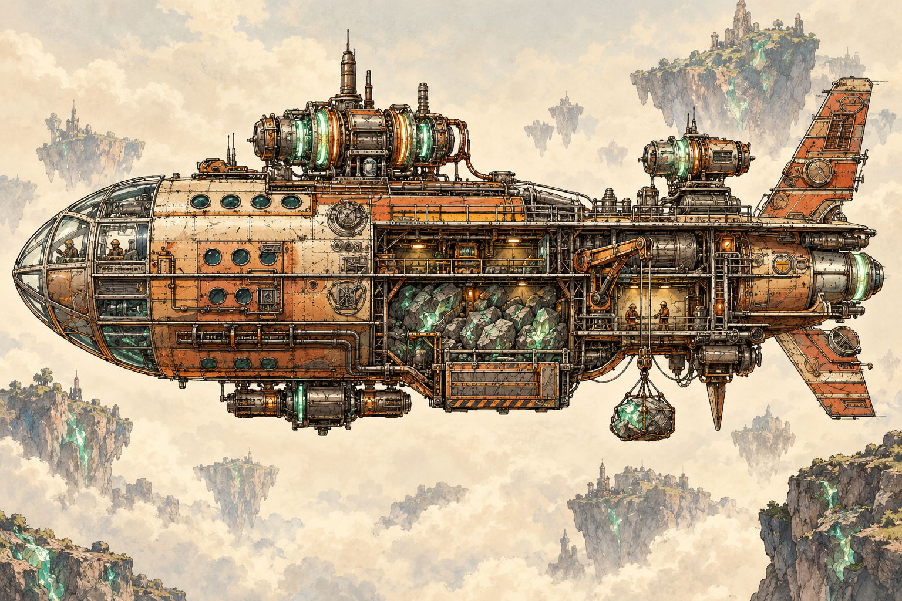
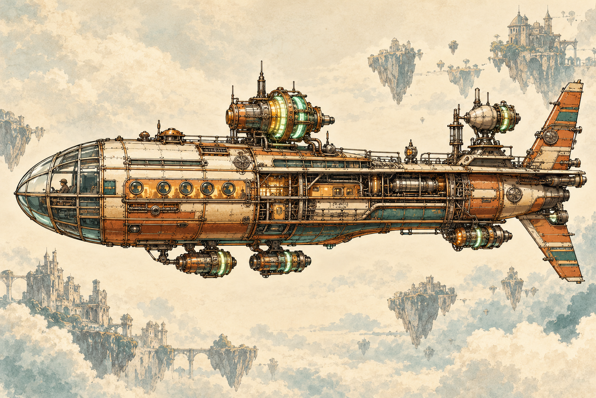
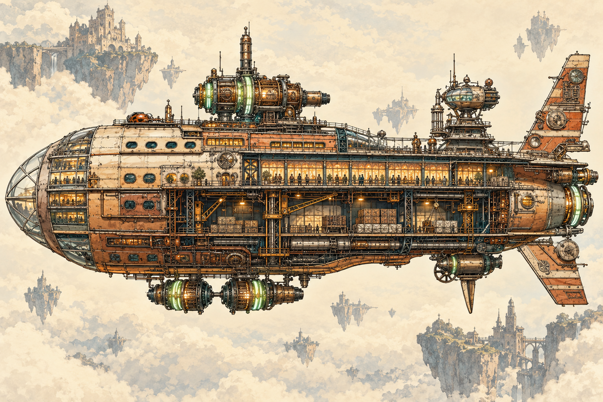
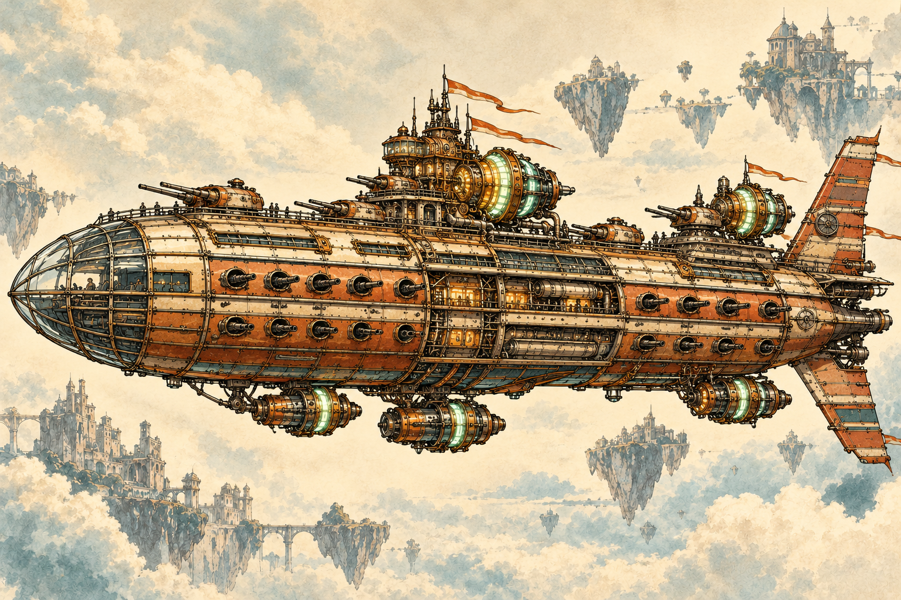

# comicbook

An HTML comic project featuring **Magneton** (working story title).

A dependency-free HTML comic book starter. Includes a responsive four-page world-building prologue, generated panel illustrations, a four-class fleet gallery and ten-design ship glossary, accessible reader controls, and keyboard navigation. No build tools, accounts, API keys, or external services are required.

## Run locally

From the repository root:

```sh
python3 -m http.server 8000 --bind 127.0.0.1
```

Open the site in your local browser on port 8000.

## GitHub hosting

[Read the comic on GitHub Pages](https://mushfequr-rahman.github.io/ask-out-jessie/).

GitHub Pages publishes the `master` branch from the repository root. The `.nojekyll` file serves the HTML and assets directly, with no build tools. Pushing to `master` triggers GitHub's Pages deployment. In repository Settings → Pages, keep **Deploy from a branch**, **master**, and **/ (root)** selected. If the repository is renamed, update this link to the new repository path.

[Compare all ten ship designs in the glossary](https://mushfequr-rahman.github.io/ask-out-jessie/glossary.html).

To read the comic, select **Read the Prologue** (or open the hosted site at `#reader`), scroll through the panels, then select **Next Page** at the bottom. Previous and arrow keys work too.

The fleet section links each ship image to its full-resolution, GitHub-hosted PNG. Images can also be viewed directly from the repository's `assets/` folder.

## Zeppelin fleet

| Mining ship | Schooner |
| --- | --- |
| [](assets/mining-ship.png) | [](assets/schooner.png) |
| Small ore carrier with a large hold. | Small, highly mobile city and duchy transport. |

| Trading ship | Man-of-war |
| --- | --- |
| [](assets/trading-ship.png) | [](assets/man-of-war.png) |
| Large freight and passenger vessel; difficult to navigate. | The rarest and most expensive class; many duchies have at most three. |

Select an image for the full-size artwork, or use **The Fleet** in the hosted comic.

## Make it your comic

- `index.html`: comic title, description, story panels, and page articles.
- `styles.css`: colors, typography, responsive layout, and artwork presentation.
- `script.js`: previous/next controls and arrow-key navigation.
- `glossary.html`: all ten ship designs, comparison table, and design notes.
- `glossary.js`: optional ship-class filters; all designs remain visible without JavaScript.
- `assets/`: place your own artwork here and reference it with relative image paths. Include descriptive alt text.

To add a page, add another `article.comic-page` before the reader controls with a unique ID, a heading connected with `aria-labelledby`, and the `hidden` attribute. Update the initial page count in the HTML; JavaScript calculates subsequent counts automatically. Keep the first page visible so the comic remains readable without JavaScript.

## Verify changes

Serve the root folder and check all four comic pages, boundary button states, keyboard navigation, and a narrow mobile viewport. Check the browser console for errors. This starter has no package installation, build command, or test runner.

## Story reference

See [STORY.md](STORY.md) for the world premise and details still to develop. The panels use fifteen generated illustrations in a consistent graphic novel style, with selected scenes reused across the four-page prologue and ten ship designs across the fleet guide and glossary. Captions stay in HTML so they remain readable and editable. See [assets/README.md](assets/README.md) for the artwork inventory.
